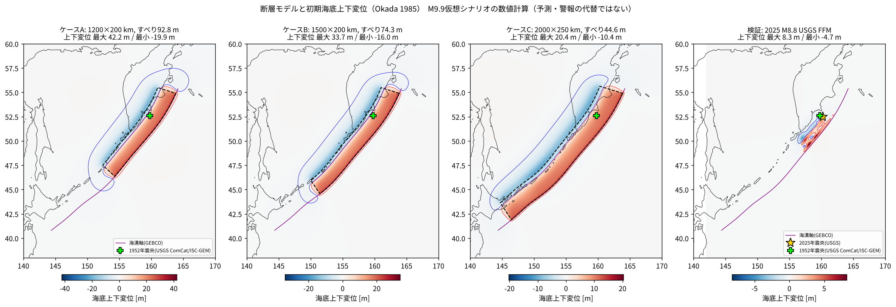
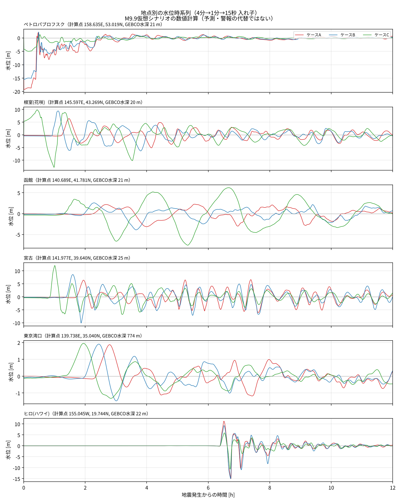
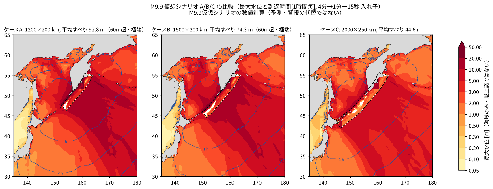

# M9.9 カムチャッカ沖 仮想地震の津波数値計算（GeoClaw）

> **これは「M9.9 仮想シナリオの数値計算」です。実際の地震・津波の予測ではなく、津波警報・注意報の代替にもなりません。**
> 防災検討の参考資料（影響の幅の把握）として、仮定した断層から計算した結果です。
> 沿岸の値は格子が粗い場所ほど信頼度が低く、**遡上高は計算していません**（沖合〜浅海域の水位として扱ってください）。

---

## 0. 計算できなかった項目・制約（最初に確認してください）

| 項目 | 状況 |
|---|---|
| 遡上高・浸水域 | **計算していない**（依頼どおり）。図表の値はすべて海域（地震前後とも海底が平均海面より下のセル）の水位 |
| 粗格子（4 分）での沿岸 3 地点 | ペトロパブロフスク・根室（花咲）・宮古は 4 分格子では計算点が陸になり**計算できなかった**。入れ子格子（15 秒）で計算し直した値を本文に示す |
| 港湾内の水位 | 函館港・東京湾内などの港湾は GEBCO（約 460 m 格子）では表現できない。**港内の値は出していない**（計算点は検潮所の沖、水深 20 m 以深の点） |
| 高解像度の沿岸地形 | 海上保安庁・内閣府・自治体の 10〜90 m 格子の地形は**入手・使用していない**（GEBCO_2026 のみ） |
| 検証: 宮古の観測値 | IOC に宮古の記録がなく、気象庁サイトからの直接取得もしていないため、**宮古での観測比較はできなかった**（近傍の大船渡で代替） |
| 検証: 東京湾口の観測値 | 湾口そのものの検潮記録は使っていない（湾口外側の布良で代替） |
| 検証: ペトロパブロフスク | 観測記録は取得できたが、振幅が 0.1 m 程度と小さく変化が緩やかで、近傍の計算（0.5 m）と大きく食い違う。検潮所の設置環境（湾奥・検潮井戸の応答）等が考えられるが**原因は確認できていない**ため、比較の参考から外して扱う |
| 気象庁の公表値との照合 | 気象庁が公表した 2025 年 7 月の各地の最大波の一覧とは**照合していない**（IOC 経由の気象庁の検潮記録で比較） |
| 分散・潮汐・破壊過程 | 分散性、潮汐、断層破壊の時間経過（シナリオ）、不均質すべり、水平変位の寄与は**考慮していない** |


---

## 1. 計算環境

| 項目 | 内容 |
|---|---|
| 計算機 | クラウド上の Linux コンテナ, Intel Xeon 2.1 GHz × 4 コア, メモリ 16 GB |
| 外部通信 | あり（プロキシ経由。GEBCO・USGS・NOAA・IOC からの取得に使用） |
| GeoClaw | clawpack **v5.13.1**（GitHub から取得。`env/setup_env.sh`） |
| コンパイラ | GNU Fortran 13.3.0（`-O2 -fopenmp`, OpenMP 4 スレッド） |
| Python | 3.13（numpy 2.5, scipy 1.18, matplotlib 3.11, netCDF4 1.7） |
| 動画 | ffmpeg 6.1 |

## 2. 使用データと出典

| データ | 内容 | 出典 |
|---|---|---|
| 水深・標高 | **GEBCO_2026 Grid**（15 秒格子, 全球 netCDF, 7.47 GB） | GEBCO Bathymetric Compilation Group 2026, doi:10.5285/4f68d5c7-45eb-f999-e063-7086abc036fa（CEDA から取得。`scripts/00_download_gebco.sh`） |
| 1952 年 カムチャッカ地震の震央 | 52.623°N, 159.779°E, Mw 9.0 | USGS ComCat / ISC-GEM `official19521104165830_30`（`data/usgs_ffm/event_1952_*.json`） |
| 2025 年 7 月 カムチャッカ地震 | 震源 52.495°N, 160.240°E, 2025-07-29 23:24:52 UTC, Mww 8.8。有限断層モデル（3 セグメント, 465 小断層, 最大すべり 39 m） | USGS `us6000qw60`（`complete_inversion.fsp` ほか, `data/usgs_ffm/`） |
| 2025 年の破壊域の参考 | 長さ約 500〜700 km（研究により 250〜700 km と幅がある）。1952 年の破壊域（シプンスキー岬〜オネコタン島, 約 600〜700 km）と大きく重なる | Wikipedia「2025 Kamchatka earthquake」「1952 Severo-Kurilsk earthquake」, SSA ニュース「Massive Kamchatka Earthquake Has Extended Rupture That Overlaps 1952 Event」, Liu et al. (Science, 2026) |
| 検証用 海底水圧計 | NOAA DART 21416, 21419, 21418, 21413, 21415, 21414, 46408（2025 年 1 分値/15 分値） | NOAA NDBC historical DART data |
| 検証用 検潮記録 | ペトロパブロフスク(petr), 釧路(kush), 花咲(hana), 函館(hako), 大船渡(ofun), 布良(mera), ヒロ(hilo)（1 分値, 2025-07-26〜08-02） | IOC Sea Level Station Monitoring Facility（日本の地点は気象庁が IOC に提供している値） |

## 3. 断層モデル

### 3.1 位置の決め方（根拠）
- 1952 年 M9.0 と 2025 年 M8.8 の震源（いずれもペトロパブロフスク・カムチャツキー沖, 52.5〜52.6°N, 159.8〜160.2°E）と破壊域（シプンスキー岬 ≈53°N 〜 オネコタン島 ≈49.5°N）を含むように置いた。
- 断層上端は **GEBCO_2026 から抽出した千島・カムチャッカ海溝軸**（各緯度で最深点を探索し平滑化, `data/trench_trace.csv`）に沿わせた。
- M9.9 の長さ 1200〜2000 km は 1952/2025 の破壊域（〜700 km）を中心に南北へ広げると北側がカムチャッカ・アリューシャン会合部（〜56°N）を越えてしまうため、**北端を会合部の手前・海溝軸が明瞭な北緯 55.0°に固定し、そこから南西へ L km** 延ばした。どのケースも 1952/2025 の破壊域全体を含む。
  - A（1200 km）: 54.9°N → 46.4°N（シムシル島付近）
  - B（1500 km）: 54.9°N → 44.6°N（択捉島沖）
  - C（2000 km）: 54.9°N → 41.9°N（十勝・根室沖まで。千島海溝のほぼ全域）

### 3.2 パラメータ

| ケース | 長さ×幅 (km) | 平均すべり μ=3e10 | μ=4e10（採用） | μ=5e10 | 走向の範囲 | 北端 | 南端 | 下端深さ | 海底変位 最大/最小 | 判定 |
|---|---|---|---|---|---|---|---|---|---|---|
| A | 1200×200 | 123.8 m | 92.8 m | 74.3 m | 201–223° | 54.90N 163.87E | 46.35N 154.32E | 57 km | 42.2 / -19.9 m | **60 m 超：物理的に極端** |
| B | 1500×200 | 99.0 m | 74.3 m | 59.4 m | 201–235° | 54.90N 163.87E | 44.56N 151.45E | 57 km | 33.7 / -16.0 m | **60 m 超：物理的に極端** |
| C | 2000×250 | 59.4 m | 44.6 m | 35.7 m | 201–237° | 54.90N 163.87E | 41.89N 146.48E | 70 km | 20.4 / -10.4 m | 60 m 以下 |

- **走向**: 依頼は約 200〜220° だが、海溝軸に沿わせることを優先した。カムチャッカ沖（A の範囲）は 201〜223° で依頼範囲にほぼ収まるが、**千島海溝南部は海溝自体が 230° 台に曲がるため B・C では最大 235〜237° となった**（直線 215° の断層にすると南端で海溝から 300 km 以上外れ、太平洋プレート側に断層を置くことになるため）。
- **傾斜 15°**（依頼範囲 15〜25° の下限）。幅 200〜250 km を 20° 以上で傾けると下端深さが 75〜90 km になり、プレート境界の固着域として深すぎるため。下端深さは A・B 57 km、C 70 km。
- **すべり角 90°**、上端深さ 5 km、一様すべり、瞬時破壊（破壊の伝播は考慮しない）。
- 平均すべり量 D = M0 / (μ·L·W)、M0 = 10^(1.5×9.9+9.1) = 8.91×10²³ N·m。μ = 4.0×10¹⁰ Pa を採用（沈み込み帯の津波評価で一般的な値）。
- **A（92.8 m）と B（74.3 m）は平均すべりが 60 m を超え、物理的に極端**です。参考として 2011 年東北沖（Mw 9.0〜9.1）は、海溝付近の最大すべりが約 50 m 前後（モデルにより 30〜80 m と幅がある）、断層全体の平均は 10〜20 m 程度とされます（この数値は一般的な文献値の概略で、本作業で個別に再確認はしていません）。C（44.6 m）も μ = 3×10¹⁰ なら 59.4 m とほぼ目安に達します。M9.9 を 1200〜2000 km の断層で実現しようとすると、すべり量が非常に大きくならざるを得ない、という点自体がこのシナリオの特徴です。
- dtopotools で各小断層から再計算した Mw は 9.93（Mw の換算式の定数 9.1 と 9.05 の違いによる）。

### 3.3 初期水位（海底上下変位）
- Okada (1985) の弾性半無限体の式で海底の上下変位を計算（`clawpack.geoclaw.dtopotools`）。水平変位の寄与（Tanioka & Satake, 1996）は含めない。
- **注意**: M9.9 では Okada の変位が断層から 1000 km 離れても 10〜20 cm 残る。最初に断層の周囲 ±3° で計算したところ、格子の端で最大 0.74 m の変位が打ち切られ、偽の段差波源になっていた。そこで **±12° の範囲で計算し、外周 2° でコサイン型に 0 へ減衰**させた（打ち切り前の端の値は `data/dtopo_edge_check.txt`: A 0.20 m, B 0.18 m, C 0.15 m）。
- 図: `results/fault_dtopo.png`



## 4. 計算設定

| 項目 | 設定 |
|---|---|
| 支配方程式 | 非線形浅水方程式（GeoClaw, 有限体積法, f-wave, MC limiter, 2 次精度）。**分散性は考慮しない** |
| 計算領域 | 東経 128°〜西経 150°（210°E）, 北緯 15°〜65°。依頼の広域（135〜180°E, 30〜65°N）にヒロ（19.7°N, 155.1°W）を含めるため東・南へ拡張 |
| 座標 | 球面座標（緯度経度）、コリオリ力なし |
| 格子 Level 1 | **4 分**（1230 × 750 = 92.3 万セル。南北 7.4 km, 東西 4.8 km @50°N） |
| 格子 Level 2 | **1 分**（約 1.9 km）: 北海道・東北太平洋側(139–146.8°E, 38.6–44.2°N), 関東, ペトロパブロフスク, ヒロ の周辺。水位変動 2 cm 以上で自動細分化 |
| 格子 Level 3 | **15 秒**（約 460 m × 350 m @41.8°N, GEBCO 原解像度）: 函館周辺（139.95–141.45°E, 41.30–42.05°N）、根室・宮古・東京湾口・ペトロパブロフスク・ヒロ周辺の小領域。粗格子計算の到達時間の 30 分前から強制、観測点の ±0.04° は 0 秒から強制 |
| 時間刻み | CFL 0.75 の可変時間刻み（Level 1 でおよそ 10〜20 秒、細格子は自動で細分） |
| 計算時間 | 地震発生から **12 時間** |
| 海面 | 平均海面（GEBCO の 0 m）。**潮汐は考慮しない** |
| 底面摩擦 | Manning n = 0.025 |
| 境界条件 | 外側境界は透過（extrapolation） |
| 出力 | fgmax（最大水位）: 広域 4 分、北海道・東北 1 分、函館 15 秒。fgout（スナップショット）: 広域 6 分 × 2 分毎、函館 15 秒 × 2 分毎。観測点: 15 秒毎 |

### 4.1 到達時間の定義
**地殻変動の完了後、直近 10 分間で水位が 0.2 m 以上変化した最初の時刻**（M9.9 シナリオ。気象庁の津波注意報の下限 0.2 m に相当する「有意な津波」）。2 分毎のスナップショットから計算するため、時間分解能は 2 分。
- 静水面からの +5 cm で判定すると、M9.9 では Okada の静的変位（遠方でも 10〜20 cm）がゆっくり緩和する長周期の変動（〜0.1 m/時）を「到達」と誤判定したため、この定義にした。**到達時間より前に、数 cm〜15 cm 程度の緩やかな水位変化が始まっている場合があります。**
- 2025 年 M8.8 の検証計算では静的変位が小さいので 5 cm で判定。

### 4.2 観測点（計算点）
検潮所の位置は 15 秒格子でも陸になったり、M9.9 の引き波で干上がったりするため、**最寄りの水深 20 m 以深の点**に移して計算した（`data/gauges_adjusted.csv`）。値は検潮所そのものではなく、その沖合（数百 m〜3 km）の値です。

| 地点 | 公称位置 | 計算点 | 計算点の水深 (GEBCO) | 移動距離 |
|---|---|---|---|---|
| ペトロパブロフスク（検潮所） | 158.650°E, 53.017°N | 158.635°E, 53.019°N | 21 m | 0.99 km |
| 根室・花咲（検潮所） | 145.570°E, 43.280°N | 145.597°E, 43.269°N | 20 m | 2.52 km |
| 函館（検潮所） | 140.720°E, 41.780°N | 140.689°E, 41.781°N | 21 m | 2.60 km |
| 宮古（検潮所） | 141.975°E, 39.642°N | 141.977°E, 39.640°N | 25 m | 0.32 km |
| 東京湾口（浦賀水道南口の海域） | 139.740°E, 35.040°N | 139.738°E, 35.040°N | 774 m | 0.20 km |
| ヒロ（検潮所） | 155.060°W, 19.733°N | 155.045°W, 19.744°N | 22 m | 1.94 km |
| 釧路（検証用） | 144.370°E, 42.980°N | 144.368°E, 42.956°N | 27 m | 2.65 km |
| 大船渡（検証用） | 141.750°E, 39.020°N | 141.748°E, 39.015°N | 22 m | 0.63 km |
| 布良（検証用, 東京湾口の外側） | 139.830°E, 34.920°N | 139.815°E, 34.910°N | 20 m | 1.70 km |

DART（海底水圧計）7 点は公称位置のまま（水深 4800〜5850 m）。

## 5. 結果

### 5.1 まとめ（入れ子格子 L3: 4 分→1 分→15 秒）

主要地点の到達時間・最大水位の幅（A/B/C）:

| 地点 | 到達 A / B / C | 到達の幅 | 最大水位 A / B / C [m] | 最大水位の幅 [m] |
|---|---|---|---|---|
| ペトロパブロフスク | 0:04 / 0:04 / 0:03 | 0:03〜0:04 | 2.0 / 2.2 / 1.2 | 1.2〜2.2 |
| 根室(花咲) | 1:13 / 0:55 / 0:04 | 0:04〜1:13 | 6.4 / 9.4 / 9.8 | 6.4〜9.8 |
| 函館 | 2:15 / 1:32 / 1:18 | 1:18〜2:15 | 2.3 / 2.6 / 6.2 | 2.3〜6.2 |
| 宮古 | 1:22 / 1:21 / 0:49 | 0:49〜1:22 | 6.6 / 8.6 / 12.0 | 6.6〜12.0 |
| 東京湾口 | 2:21 / 2:01 / 1:29 | 1:29〜2:21 | 1.9 / 1.9 / 2.0 | 1.9〜2.0 |
| ヒロ(ハワイ) | 6:23 / 6:23 / 6:23 | 6:23〜6:23 | 11.2 / 9.2 / 5.9 | 5.9〜11.2 |

- 到達: 直近 10 分間で水位が 0.2 m 以上変化した最初の時刻（4.1 節）。ペトロパブロフスクと C の根室は波源域の中（または直上）で、地震直後から水位が変化する。
- **最大水位は平均海面基準**。根室（C）は地殻変動で約 5.7 m 隆起した位置の値、ペトロパブロフスク（A・B）は 15〜19 m 沈降した位置の値で、変動後の海底・地盤を基準にすると下表の右端列のとおり大きく異なる（A で約 21 m）。
- 遠地のヒロでは A > B > C（すべり量の大きい短い断層ほど大きい）、日本の太平洋沿岸では C > B > A（断層の南端が日本に近いほど大きく、早い）。東京湾口（湾口の水深 770 m 地点）は 3 ケースともほぼ 2 m 前後。

地点別の詳細（`results/gauge_summary_L3.md`, 15 秒毎の時系列は `results/<ケース>_L3/gauges_timeseries.csv`）:

| 地点 | ケース | 到達 (h:mm) | 最大水位 [m]（平均海面基準） | 最大の時刻 | 最低水位 [m] | 地殻変動による初期水位変化 [m] | 最大水位−初期変化 [m]（変動後の海底・地盤基準の目安） |
|---|---|---|---|---|---|---|---|
| ペトロパブロフスク | A | 0:04 | 1.96 | 0:27 | -19.25 | -18.86 | 20.82 |
| ペトロパブロフスク | B | 0:04 | 2.21 | 0:29 | -15.48 | -15.17 | 17.38 |
| ペトロパブロフスク | C | 0:03 | 1.22 | 0:31 | -4.99 | -4.73 | 5.94 |
| 根室(花咲) | A | 1:13 | 6.41 | 1:28 | -5.11 | -0.26 | 6.67 |
| 根室(花咲) | B | 0:55 | 9.39 | 1:07 | -6.34 | -0.42 | 9.81 |
| 根室(花咲) | C | 0:04 | 9.84 | 0:26 | -12.80 | +5.67 | 4.17 |
| 函館 | A | 2:15 | 2.26 | 5:32 | -3.14 | -0.03 | 2.29 |
| 函館 | B | 1:32 | 2.58 | 2:17 | -3.89 | -0.16 | 2.75 |
| 函館 | C | 1:18 | 6.22 | 6:40 | -7.57 | -0.35 | 6.57 |
| 宮古 | A | 1:22 | 6.62 | 7:23 | -6.07 | -0.13 | 6.75 |
| 宮古 | B | 1:21 | 8.57 | 1:36 | -10.06 | -0.17 | 8.74 |
| 宮古 | C | 0:49 | 12.04 | 1:00 | -6.77 | -0.34 | 12.38 |
| 東京湾口 | A | 2:21 | 1.87 | 2:47 | -1.18 | +0.00 | 1.87 |
| 東京湾口 | B | 2:01 | 1.91 | 2:26 | -1.47 | -0.08 | 1.99 |
| 東京湾口 | C | 1:29 | 1.95 | 1:56 | -1.32 | -0.11 | 2.07 |
| ヒロ(ハワイ) | A | 6:23 | 11.23 | 6:30 | -15.03 | +0.00 | 11.23 |
| ヒロ(ハワイ) | B | 6:23 | 9.23 | 6:30 | -15.01 | +0.00 | 9.23 |
| ヒロ(ハワイ) | C | 6:23 | 5.87 | 6:31 | -10.68 | +0.00 | 5.87 |

到達: 地殻変動完了後、直近10分間で水位が 0.2 m 以上変化した最初の時刻（有意な津波の到達。地図の到達時間と同じ定義）。それより前に数cm〜15cm程度の長周期の先行変動が現れる場合がある。初期水位変化は地震5分後の水位。水位は静水面(平均海面)基準、潮汐は考慮しない。沖合〜浅海域の計算点の値で、遡上高ではない。「一時干出」は引き波で計算点の水深がなくなったことを示し、その最低水位は計算セルの海底高さ。



### 5.2 地域の目安（入れ子格子 L3 の最大水位）

| ケース | 北海道東部太平洋側 水深20–50 m帯（中央値 / 最大） | 三陸沿岸 水深20–50 m帯（中央値 / 最大） | 函館湾（中央値 / 最大） | 函館湾への到達（中央値） |
|---|---|---|---|---|
| A | 3.6 / 9.2 m | 4.5 / 6.4 m | 2.4 / 3.9 m | 約 132 分 |
| B | 5.1 / 10.8 m | 5.5 / 8.1 m | 2.4 / 4.2 m | 約 108 分 |
| C | 6.6 / 16.6 m | 7.2 / 11.6 m | 6.1 / 7.3 m | 約 76 分 |

北海道東部: 143°E 以東・41.8°N 以北、三陸: 38.6–40.5°N・141.3–142.3°E（1 分格子）。函館湾: 140.55–140.80°E, 41.72–41.82°N（15 秒格子）。

### 5.3 図・動画

| 内容 | A | B | C |
|---|---|---|---|
| 最大水位・到達時間（依頼範囲 135–180°E, 30–65°N） | [map](results/A_L3/map_wide.png) | [map](results/B_L3/map_wide.png) | [map](results/C_L3/map_wide.png) |
| 同（計算領域全体・ハワイまで） | [map](results/A_L3/map_pacific.png) | [map](results/B_L3/map_pacific.png) | [map](results/C_L3/map_pacific.png) |
| 北海道・東北太平洋側（1 分格子） | [map](results/A_L3/map_hokkaido_tohoku.png) | [map](results/B_L3/map_hokkaido_tohoku.png) | [map](results/C_L3/map_hokkaido_tohoku.png) |
| 函館周辺（15 秒格子） | [map](results/A_L3/map_hakodate.png) | [map](results/B_L3/map_hakodate.png) | [map](results/C_L3/map_hakodate.png) |
| 伝播アニメーション（広域, 2 分毎, mp4） | [mp4](results/A_L3/animation_pacific.mp4) | [mp4](results/B_L3/animation_pacific.mp4) | [mp4](results/C_L3/animation_pacific.mp4) |
| 函館周辺アニメーション（15 秒格子, 2 分毎, mp4） | [mp4](results/A_L3/animation_hakodate.mp4) | [mp4](results/B_L3/animation_hakodate.mp4) | [mp4](results/C_L3/animation_hakodate.mp4) |



図の見方:
- 白抜き: 最大水位が凡例の下限未満の海域。**波源域内の白い帯は、地盤が大きく沈降し最大水位（平均海面基準）が低い海域**。
- 広域図には 1 分格子の範囲（北海道・東北, ペトロパブロフスク等）が四角く濃く見える部分がある。細かい格子ほど沿岸の波の高まりを表現できるためで、**格子の粗い場所の沿岸の値は過小**になっている。
- 波源域直近のカムチャッカ沿岸（ペトロパブロフスク周辺の大陸棚）では、A・B で最大水位が数十 m（最大 60 m 前後）に達するセルがある。平均すべり 74〜93 m という極端な仮定と強い非線形性・粗い格子の帰結で、**数値としての信頼度は低い**。

### 5.4 粗格子（4 分）との比較

最初に 4 分格子のみで A/B/C を計算した結果（`results/*_L1/`, `results/gauge_summary_L1.md`, `results/compare_maxmap_L1.png`）:

| 地点 | 到達 A / B / C | 到達の幅 | 最大水位 A / B / C [m] | 最大水位の幅 [m] |
|---|---|---|---|---|
| ペトロパブロフスク | — / — / — | 計算できず | — / — / — | 計算できず |
| 根室(花咲) | — / — / — | 計算できず | — / — / — | 計算できず |
| 函館 | 2:11 / 1:51 / 1:13 | 1:13〜2:11 | 1.9 / 1.7 / 4.6 | 1.7〜4.6 |
| 宮古 | — / — / — | 計算できず | — / — / — | 計算できず |
| 東京湾口 | 2:19 / 1:58 / 1:27 | 1:27〜2:19 | 1.7 / 1.7 / 1.8 | 1.7〜1.8 |
| ヒロ(ハワイ) | 6:20 / 6:20 / 6:20 | 6:20〜6:20 | 7.8 / 6.2 / 3.9 | 3.9〜7.8 |

- 4 分格子では湾・港が表現できず 3 地点は陸。函館（4.6→6.2 m, C）・ヒロ（7.8→11.2 m, A）など、細格子にすると沿岸の最大水位は大きくなる。**粗格子の沿岸値は過小評価**になる。
- 到達時間は 4 分格子と入れ子格子で数分程度の差（波の先端は沖合の深い海域の伝播で決まるため）。


## 6. 検証: 2025 年 7 月 M8.8 カムチャッカ地震の再現

USGS の有限断層モデル（`complete_inversion.fsp`, 3 セグメント・465 小断層, 破壊継続 約 270 秒をキネマティックに与えた）から、シナリオと同じ手順（Okada → GeoClaw, 同じ格子）で計算し、観測と比較した。

- DART: [validation_dart.png](results/V2025_L3/validation_dart.png)、検潮所: [validation_tide.png](results/V2025_L3/validation_tide.png)

| 地点 | 観測 最大水位 [m] | 計算 最大水位 [m] | 計算/観測 | 観測 最大の時刻 (h) | 計算 最大の時刻 (h) | 計算 第1波到達 (h) |
|---|---|---|---|---|---|---|
| DART21416 | 0.66 | 1.68 | 2.55 | 0.54 | 0.50 | 0.47 |
| DART21419 | 0.20 | 0.35 | 1.78 | 0.74 | 0.79 | 0.63 |
| DART21418 | 0.09 | 0.11 | 1.21 | 1.75 | 1.75 | 1.58 |
| DART21413 | 0.07 | 0.15 | 1.99 | 2.62 | 2.63 | 2.50 |
| DART21415 | 0.30 | 0.39 | 1.31 | 1.17 | 1.11 | 1.00 |
| DART21414 | 0.27 | 0.37 | 1.38 | 1.77 | 1.70 | 1.59 |
| DART46408 | 0.09 | 0.19 | 1.97 | 2.84 | 2.90 | 2.60 |
| ペトロパブロフスク | 0.11 | 0.49 | 4.29 | 1.87 | 0.80 | 0.56 |
| 釧路 | 0.32 | 0.18 | 0.56 | 2.30 | 2.15 | 1.93 |
| 根室(花咲) | 0.32 | 0.35 | 1.11 | 4.20 | 4.08 | 1.82 |
| 函館 | 0.13 | 0.12 | 0.89 | 5.75 | 3.22 | 2.98 |
| 大船渡 | 0.21 | 0.25 | 1.23 | 5.32 | 5.21 | 2.40 |
| 布良 | 0.21 | 0.16 | 0.78 | 5.57 | 5.80 | 2.91 |
| ヒロ(ハワイ) | 1.07 | 0.87 | 0.81 | 7.74 | 7.44 | 6.45 |

比較窓（図の黄色帯）: 計算の第1波到達（DART 2 cm / 検潮所 5 cm 超過）の 30 分前〜3 時間後。観測は潮汐除去後に 5 分移動平均。計算点が陸（乾燥）になった地点は空欄(nan)。

**評価**
- **到達・波の位相**: DART（深海）では最大波の時刻が観測と ±5 分以内で一致（計算の方がやや早い地点と遅い地点がある）。日本の検潮所（根室・函館・釧路・大船渡）でも最初の 2〜3 時間の波形の位相がよく合う。
- **振幅**: DART（深海）では計算が観測の 1.2〜2.6 倍と**過大**（USGS の有限断層モデルは地震波・測地データから推定したもので津波に合わせて調整されていないこと、非分散の計算で短周期成分が強く残ることが主な要因と考えられる）。日本の沿岸（根室 1.1 倍、函館 0.9 倍、大船渡 1.2 倍、釧路 0.6 倍、布良 0.8 倍）とヒロ（0.8 倍）はおおむね 0.6〜1.2 倍。
- **後続波**: 3〜4 時間以降は、計算点（検潮所の沖）と実際の検潮所（港内）の違いや、港・湾の副振動を GEBCO 格子で表現できないため、観測との一致は悪くなる。
- **4 分格子のみ（L1）**では、ペトロパブロフスク・花咲・大船渡が陸になって比較できず、函館・布良・ヒロは観測の 0.3〜0.6 倍と過小だった。入れ子格子（L3）が必要であることを示している。
- この検証から、本手順の **沖合〜浅海域の到達時間は数分の精度、最大水位はおおむね 0.5〜2 倍程度の幅**で見るのが妥当（M9.9 シナリオではそれに加えて断層モデル自体の仮定の不確かさが大きい）。


## 7. 実行時間

4 コア（OpenMP 4 スレッド）での GeoClaw の実行時間（12 時間分の計算）:

| ケース | 4 分格子のみ（L1） | 入れ子 4分→1分→15秒（L3） |
|---|---|---|
| A | 19 分（1143 秒） | 48 分（2859 秒） |
| B | 23 分（1377 秒） | 51 分（3059 秒） |
| C | 19 分（1134 秒） | 52 分（3099 秒） |
| 2025 年 M8.8（検証） | 20 分（1208 秒） | 48 分（2896 秒） |

そのほか: GEBCO_2026 取得 約 5 分（7.5 GB）、地形ファイル作成 数秒、初期変位（Okada）計算 1 ケース 1〜2 分、図の作成 1 ケース 1 分以内、アニメーション 1 本 2〜4 分。作業全体（試行錯誤を含む）は約 7 時間。


## 8. 再実行の手順

```bash
cd tsunami-sim
sudo bash env/setup_env.sh          # gfortran, ffmpeg, Python パッケージ, clawpack v5.13.1
source env/env.sh                   # CLAW, PYTHONPATH, OMP_NUM_THREADS など
bash scripts/00_download_gebco.sh   # GEBCO_2026 (7.5 GB) → /opt/gebco/
cd scripts
python3 01_download_obs.py          # USGS 有限断層・DART・IOC 検潮（検証用）
python3 02_make_topo.py             # 地形ファイル・海溝軸・観測点位置
python3 03_make_dtopo.py            # 断層 A/B/C と 2025 年モデルの初期変位（約 5 分）
python3 03b_plot_dtopo.py
for c in A B C V2025; do bash 04_run.sh $c 1; done   # 粗格子（4 分）各 20 分程度
for c in A B C V2025; do bash 04_run.sh $c 3; done   # 入れ子（15 秒まで）各 50〜60 分
for c in A B C; do python3 05_plot_maps.py $c 3; python3 07_animation.py $c 3; done
python3 06_gauges.py 3 A B C
python3 09_compare.py 3
python3 05_plot_maps.py V2025 3; python3 08_validate.py 3
```
- 大きい中間ファイル（GEBCO, 地形, 初期変位, GeoClaw 出力 各 1.4 GB 程度）は `work/` に置き、git 管理外。
- 計算時間を短く試すときは `TFINAL=3600 bash 04_run.sh A 1` のように環境変数で短縮できる。

### ファイル構成
```
tsunami-sim/
├── README.md
├── env/          setup_env.sh（導入）, env.sh（環境変数）
├── geoclaw/      setrun.py（GeoClaw 設定。CASE, MAXLEVEL を環境変数で切替）, Makefile
├── scripts/      00〜09 の処理スクリプト, common.py（共通設定）, viz.py（描画・読込）
├── data/         観測データ・断層・海溝軸・観測点位置（小さいもの）
├── results/      図・動画・表（ケース別フォルダ <ケース>_L<格子>）
└── work/         大きい中間ファイル（git 管理外）
```

## 9. 結果を使うときの注意（限界）

- **仮想シナリオ**: M9.9 は千島・カムチャッカ海溝で知られている最大（1952 年 M9.0）を大きく上回る仮定です。A・B は平均すべり 60 m 超で物理的に極端です。
- **沿岸の値の信頼度**: 4 分格子（約 7 km）では湾や港が表現できず、宮古・根室・ペトロパブロフスクは計算点が陸になります。15 秒格子（約 460 m）でも GEBCO は港湾・防波堤・浅い湾内を正確に表現しておらず、函館港・東京湾内の値は参考程度です。自治体の詳細検討には、海上保安庁・内閣府・都道府県の高解像度地形（10 m〜90 m 格子）と遡上計算が必要です。
- **遡上高・浸水は出していません**。図の最大水位は海域（海底が平均海面より下）のセルのみです。
- **非分散の浅水方程式**: 遠地（ヒロ, DART）では短周期成分の振幅を過大に、到達を数分早く見積もる傾向があります（検証参照）。
- **瞬時・一様すべり**: 実際の M9.9 は破壊に 5〜10 分以上かかり、すべりは不均質です。近地の波形・最大値は破壊過程によって大きく変わります。
- **潮汐なし**: 満潮時に重なると水位はさらに高くなります。
- **最大水位は平均海面基準**で、地殻変動による海面の昇降を含みます（波源域の白抜きは、地盤が大きく沈降し最大水位が 0.05 m に届かない海域）。
